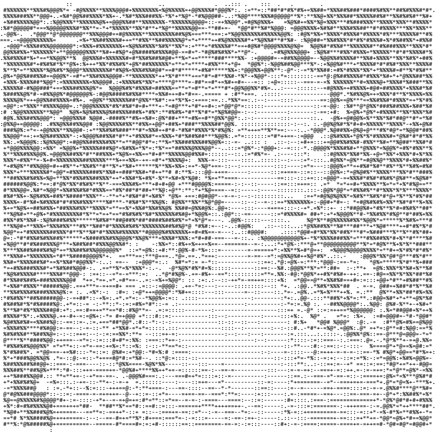
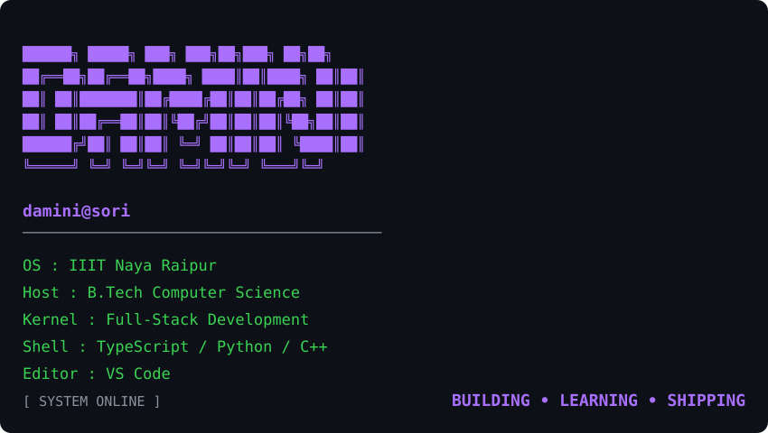

  

<!-- Animated Terminal Header -->

 

<code>daminisori@github ~ $ ./contributions.sh</code>

  <code>damini@sori:~$ neofetch</code>

<table>
  <tr>
    <td width="35%" align="center" valign="middle">
      
    </td>
    <td width="65%" valign="middle">
      
    </td>
  </tr>
</table>

  

<code>[ SYSTEM ONLINE ]</code>

  

<h2>./github_stats.sh</h2>

  

  

<h2 align="center">./my_git_bonsai.sh 🌳</h2>

  

  <i>Every commit helps my tree grow.</i>

<!-- PROJECTS SECTION -->
<h2>./projects.sh</h2>

  
  

  <code>damini@sori:~$ ./projects.sh</code>

<h2 align="center">
  ▌ FEATURED PROJECTS
</h2>

<table>
<tr>
<td width="50%" valign="top">

<h3>💜 01. CAMPUS-CARE</h3>

**Campus Support Platform**

A platform focused on campus complaints and scholarship assistance.

  

</td>
<td width="50%" valign="top">

<h3>💜 02. ANIMAKER</h3>

**Creative Web Development**

A JavaScript-based development project.

  

</td>
</tr>
<tr>
<td colspan="2" valign="top">

<h3>💜 03. ABOUT-ME</h3>

**Personal Developer Portfolio**

A personal portfolio built with React, TypeScript and Remotion.

  

</td>
</tr>
</table>

  <code>[ MORE PROJECTS COMING SOON ]</code>

<code>daminisori@github ~ $ ./links.sh</code>

  
  
  
  

 

